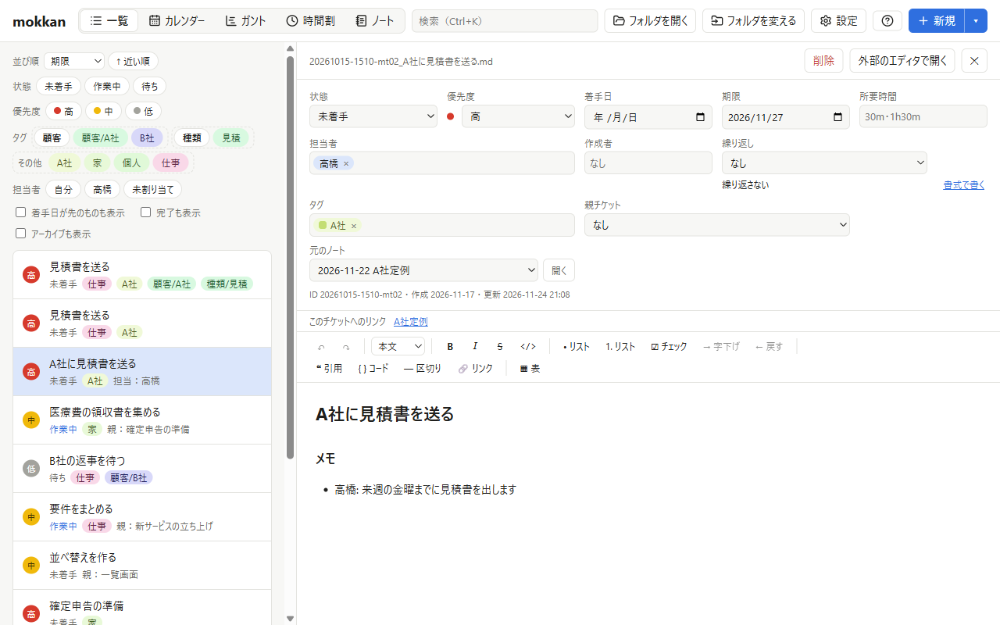
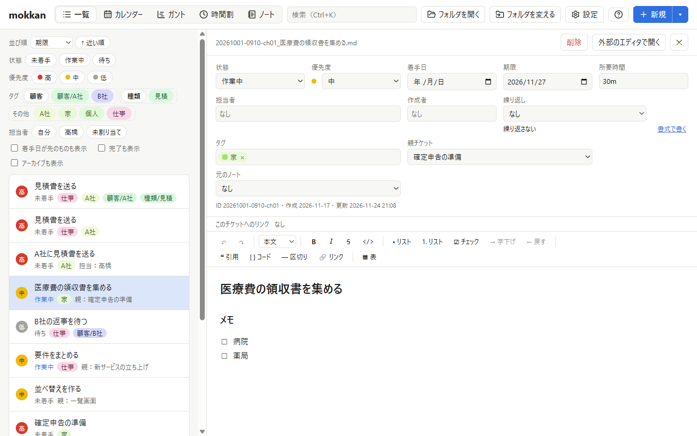
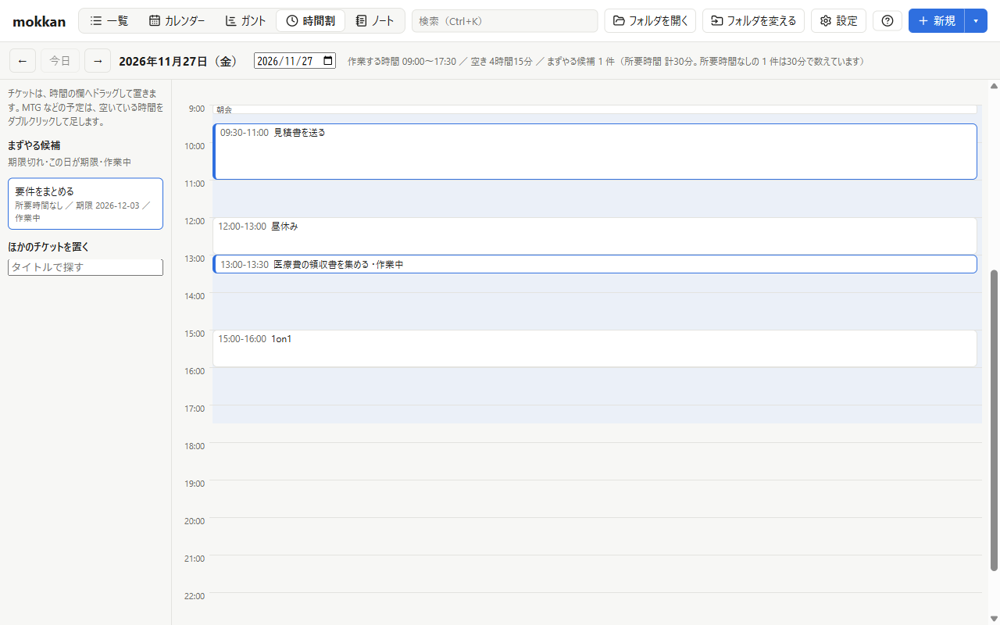
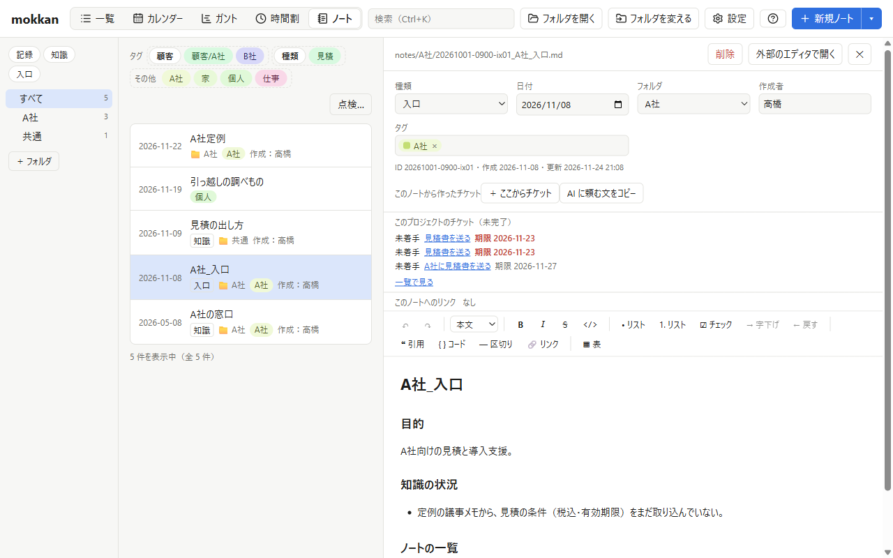
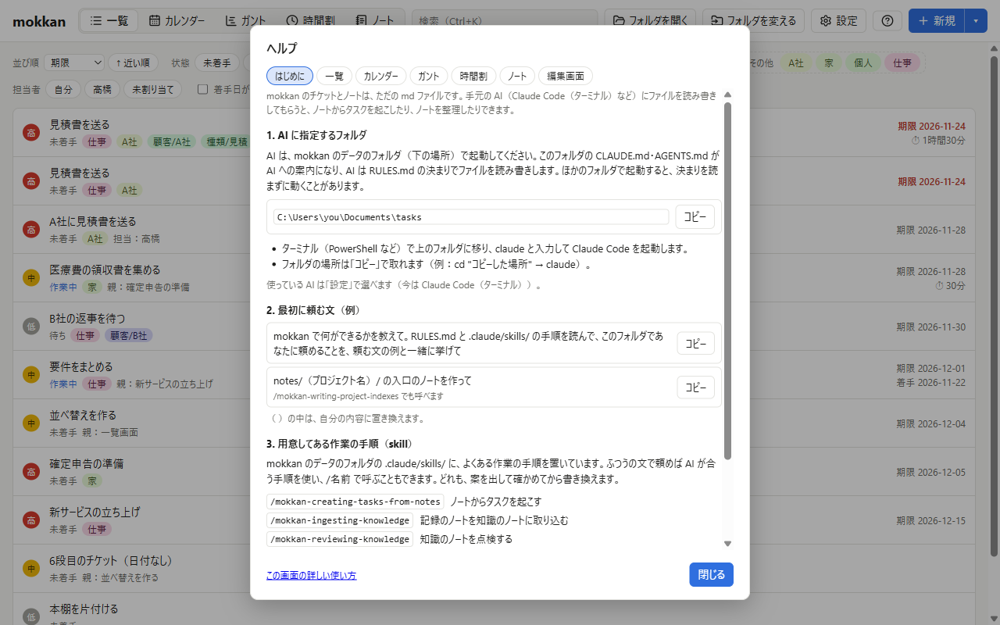

# mokkan

標準のmdファイル群をデータベースにした、個人用のタスク管理デスクトップアプリです（Windows・Linux 用。Mac 版は基本の動作だけを確かめています）。



- 1チケット＝1つのmdファイル。YAMLのfrontmatterで状態や期限を持ち、本文にタイトルとメモを書きます。
- 特定のツールの独自記法を使わない標準mdなので、ほかのエディタやGitHubで開いても崩れません。
- AI はファイルを直接読み書きするだけでタスクやノートを扱えます。想定している使い方は、AI の skill として用意しています。
- アプリで開いて保存しても、編集していない部分は1文字も変えません。AIやGitと一緒に使えます。

画面ごとにできることは、[使い方](docs/guide.md) にまとめています（アプリの「？」からも開けます）。

## できること

### チケット

1チケット＝1ファイルで、状態・優先度・着手日・期限・所要時間・繰り返し・担当者・タグ・親チケットを持ちます。「＋ 新規」（Ctrl+N）で作り、テンプレートも選べます。繰り返しのチケットは、完了にすると次回分ができます。完了したものはアーカイブで片付け、要らなくなったものは削除で OS のごみ箱に移します。→ [一覧](docs/guide.md#一覧)・[編集画面](docs/guide.md#編集画面)



### 見る

一覧（並び順と、状態・優先度・タグ・担当者の絞り込み）・カレンダー・ガントチャート（親子の階層や、タグごとにまとめる）・時間割で見ます。時間割では、その日の候補のチケットをドラッグして時間に置き、MTG などの予定も足して、一日を組みます。Ctrl+K でチケットとノートを探せます。→ [カレンダー](docs/guide.md#カレンダー)・[ガント](docs/guide.md#ガント)・[時間割](docs/guide.md#時間割)



### ノート

議事メモ・手順・調べたことなどを、チケットと同じフォルダに書きます。プロジェクトごとのフォルダに分け、記録（その時のこと）・知識（今の正しい状態）・入口（プロジェクトの案内）を分けて書きます。ノートからチケットを起こすと、ノートとチケットがつながります。「点検」で、切れたリンクや長く見直していない知識を見つけます。→ [ノート](docs/guide.md#ノート)



### AI と使う

ファイルを読み書きできる AI のアプリ（Claude Code・Claude のデスクトップアプリの Code・Cursor など）を `tasks` フォルダで使います。AI は `RULES.md` の決まりで読み書きし、よくある作業（ノートからタスクを起こす・記録を知識に取り込む・知識を点検する・入口のノートを作る・チケットを整理する・時間割を組む）は標準の skill の手順で、案を出して人が確かめてから行います。ヘルプには、頼む文の例をコピーできるように並べています。→ [AI と使う](docs/guide.md#ai-と使う)



### ファイルとして安心して使える

AI・ほかのエディタ・クラウドの同期で変わったファイルは、すぐ画面に反映します。編集中に外で変わったときは、上書きせずにどちらを残すか選べます。同期の競合コピーや ID の食い違いは警告で知らせます。→ [ファイルの決まり](docs/guide.md#ファイルの決まり)・[警告](docs/guide.md#警告)
## 動作環境

- Windows 10 / 11（64ビット）
- Linux：Ubuntu・Debian など、deb のパッケージをインストールできるもの（x64）。Ubuntu 26.04（WSL2）で確かめています。
- macOS（Apple シリコンと Intel）：基本の動作だけを確かめています（Apple シリコンの Mac で、一通りの操作）。動作は保証しません。
- AI と一緒に使うときは、ファイルを読み書きできる AI のアプリ（[Claude Code](https://code.claude.com/docs/en/overview)・Claude のデスクトップアプリの Code・[Cursor](https://cursor.com/) など）を `tasks` フォルダで使います。アプリが AI を呼ぶことはないので、mokkan の側で AI をインストールしたり設定したりする必要はありません。

ほかの環境（rpm を使う Linux・arm64 など）では、[ソースから作る](#ソースから作る)ことができます（試していません）。

## インストール

### Windows

1. GitHub の [Releases](https://github.com/kanjiyamamoto66/mokkan/releases) から `mokkan-<版>-setup.exe` を取ってきます。同じ Release の `SHA256SUMS.txt` で、取ってきたファイルが壊れていないかを確かめられます。PowerShell で `(Get-FileHash .\mokkan-<版>-setup.exe).Hash` を実行し、出た値が `SHA256SUMS.txt` の値と同じかを見てください（大文字と小文字の違いは気にしなくて構いません）。
2. ダブルクリックすると、そのまま自分のユーザー用にインストールされます（インストール先は `%LOCALAPPDATA%\Programs\mokkan`。管理者権限は要りません）。デスクトップとスタートメニューにショートカットができます。
3. コード署名をしていないので、初回は「Windows によって PC が保護されました」と出ることがあります。「詳細情報」→「実行」で進めてください。

新しい版は、新しい setup.exe を同じように実行してインストールすれば、前の版が置き換わります（自動更新はありません）。アンインストールは「設定」→「アプリ」から行います。アプリの設定（`%APPDATA%\mokkan`）と `tasks` フォルダの中身は、アンインストールしても消えません。

### Linux（Ubuntu・Debian）

1. GitHub の Releases から `mokkan-<版>-linux-amd64.deb` を取ってきます。`sha256sum mokkan-<版>-linux-amd64.deb` の値が、同じ Release の `SHA256SUMS.txt` の値と同じかで、壊れていないかを確かめられます。
2. 取ってきたフォルダで `sudo apt install ./mokkan-<版>-linux-amd64.deb` を実行します（`./` を付けてください）。足りないライブラリと、日本語と絵文字のフォント（`fonts-noto-cjk`・`fonts-noto-color-emoji`）も一緒にインストールされます。
3. アプリの一覧の「mokkan」か、端末の `mokkan` で起動します。

インストール先は `/opt/mokkan` です。Ubuntu 24.04 以降では、画面を守る仕組み（sandbox）が動くよう、mokkan 用の AppArmor のプロファイル（`/etc/apparmor.d/mokkan`）も置きます。新しい版は、新しい deb を同じように `sudo apt install ./…deb` でインストールすれば、前の版が置き換わります（自動更新はありません）。アンインストールは `sudo apt remove mokkan` です。アプリの設定（`~/.config/mokkan`）と `tasks` フォルダの中身は、アンインストールしても消えません。

### Mac（基本の動作の確認のみ）

1. GitHub の Releases から、Mac の種類に合う zip を取ってきます。Apple シリコン（M1 以降）は `mokkan-<版>-mac-arm64.zip`、Intel は `mokkan-<版>-mac-x64.zip` です。どちらか分からないときは、アップルメニュー →「この Mac について」の「チップ」（Apple M… なら Apple シリコン）か「プロセッサ」（Intel なら Intel）で確かめられます。
2. zip を開いてできた `mokkan.app` を「アプリケーション」フォルダに移します。
3. Apple の公証（notarization）をしていないので、初回は「“mokkan”は開いていません」「Apple は…を検証できませんでした」と出て開けません。「完了」で閉じてから、システム設定 →「プライバシーとセキュリティ」を開き、下のほうの「“mokkan”は Mac を保護するためにブロックされました」の横の「このまま開く」を押してください（もう一度確かめられたら「このまま開く」を押し、パスワードか Touch ID で許可します）。2回目からは普通に開けます。

ウィンドウを閉じてもアプリは終わりません（Mac の他のアプリと同じ）。終わるときは ⌘Q です。アプリの設定は `~/Library/Application Support/mokkan` に置きます。

### ソースから作る

配っているファイルを使わずに、自分でソースからインストーラーやアプリを作れます。[Git](https://git-scm.com/) と [Node.js](https://nodejs.org/) 24 が要ります。作るのは、使う OS の上で行います。

```bash
git clone --branch v<版> https://github.com/kanjiyamamoto66/mokkan.git
cd mokkan
npm ci
```

続けて、OS に合わせて1つを実行します。できたものは `dist/` にあり、インストールのしかたは上の各 OS と同じです。

| OS | コマンド | できるもの |
| --- | --- | --- |
| Windows | `npm run build:win` | `mokkan-<版>-setup.exe` |
| Linux | `npm run build:linux` | `mokkan-<版>-linux-amd64.deb` |
| Mac | `npm run build:mac` | `mokkan-<版>-mac-arm64.zip`・`mokkan-<版>-mac-x64.zip` |

- Windows で、インストーラーを作る段階で止まるとき（スマート アプリ コントロールが、署名のないインストーラーの作成に使うプログラムを止めることがあります）は、その前にできている `dist/win-unpacked/mokkan.exe` をそのまま起動して使えます。
- Linux の rpm や arm64 などは、`npm run build` の後に `npx electron-builder --linux rpm --x64`・`npx electron-builder --linux deb --arm64` のように形式と種類を指定して作れます（試していません）。

## 使い方

1. 起動したら、チケットを置く `tasks` フォルダを選びます。Google Drive・OneDrive・Dropbox などの同期フォルダの中を選ぶと、複数のPCで使えます（ファイルを PC にも置く設定にしてください。クラウドにだけ置く設定では、変更に気付けないことがあります）。
2. 空のフォルダなら「準備する」で、`tickets/`・`notes/共通/` と `RULES.md`・テンプレート・AI 向けの案内（`CLAUDE.md`・`AGENTS.md`）・skill（`.claude/skills/`）を置きます。
3. 「設定」で自分の名前を入力します（初めての起動では、設定ボタンに印が付きます）。名前は、作ったチケットの作成者と担当者の欄に使われ、担当者の絞り込みで「自分」を選べるようになります。
4. 「＋新規」でチケットを作ります。画面上部で「一覧／カレンダー／ガント／時間割／ノート」を切り替えます。
5. 新しい版をインストールしたら、設定の「ルールのファイル」で `tasks/` の RULES.md や skill などを最新にします（違うときは、設定ボタンに印が付きます）。

AIにタスクを扱わせるときは、AI を `tasks` フォルダで起動してください。`CLAUDE.md`・`AGENTS.md` の案内で `tasks/RULES.md` を先に読み、作業の手順は skill に従います。起動のしかたは、上の「？」の「はじめに」にあります。

## 使う前に知っておいてほしいこと

- **まだ 0.x 版です。** 大事なデータで使うときは、`tasks` フォルダのバックアップを取ってください。
- **アプリはファイルの名前を変えることがあります。** 起動したときに、`tickets/`・`notes/`（その下のフォルダも）の ID だけの名前のファイル（作成者が自分か空のもの）に見出しを付け足します。ほかのファイルの名前は変えません。ノートを別のフォルダに移したときは、名前は変えずに移します。
- **削除はごみ箱に移すだけです。** アプリがファイルを完全に消すのは、自分で作って何も書かずに閉じたチケットとノートだけです。
- **AI のアプリは `tasks` フォルダのファイルを自分で読みます。** 議事メモの文字起こしなど、AI に読ませたくないものがあるときは、別のファイルやフォルダに分けるか、頼むときに「読まないで」と書き添えてください。読ませた内容の扱いは、使っている AI のサービスの利用規約に従います。mokkan のアプリ自身は、ファイルの中身をどこにも送りません。

## ドキュメント

- [使い方](docs/guide.md)：画面ごとにできること
- [仕様書](docs/spec.md)：設計の考え方・データの形・機能
- [書き方のルール（RULES.md の原本）](templates/RULES.md)・[AI 向けの作業の手順（skill の原本）](templates/skills/)
- [チケットのテンプレート（TEMPLATE.md の原本）](templates/TEMPLATE.md)・[ノートのテンプレート（NOTE_TEMPLATE.md の原本）](templates/NOTE_TEMPLATE.md)・[ノートのテンプレートの見本](templates/samples/notes/)
- [CLAUDE.md](CLAUDE.md)：開発する人（と AI）向けの、コードの置き場所と実装の注意

## 開発の始め方

Node.js 24（`.node-version` に記載）が必要です。[fnm](https://github.com/Schniz/fnm) を使うと、このフォルダに移ったとき（`cd` したとき）に自動で切り替わります。

```bash
npm install
npm run sandbox
npm run dev
```

`npm run sandbox` は、動作確認用のサンプルデータを `sandbox/tasks` に作ります（Gitの管理外）。開発モードは既定でこのフォルダを読みます。

| コマンド | 内容 |
| --- | --- |
| `npm run dev` | 開発モードで起動する（画面の変更はすぐ反映、裏方を変えたら自動で再起動） |
| `npm run sandbox` | 動作確認用のサンプルデータを作る |
| `npm test` | テストを実行する（Vitest） |
| `npm run typecheck` | 型チェック |
| `npm run lint` | ESLint |
| `npm run format` | Prettierで整形する（mdは対象外） |
| `npm run build:win` | Windows用のインストーラーを `dist/` に作る |
| `npm run build:mac` | Mac 用のアプリ（Apple シリコン用と Intel 用の zip）を `dist/` に作る（Mac の上でだけ動く） |
| `npm run build:linux` | Linux 用の deb（x64）を `dist/` に作る（Linux の上でだけ動く） |
| `npm run icons` | `build/icon.svg` からアプリのアイコン（ico・png）を作り直す |
| `npm run screenshots` | 使い方と README のスクリーンショット（`docs/images/`）を撮り直す（手順は `scripts/take-screenshots.mjs` の先頭） |
| `npm run skill-evals` | 標準の skill の評価を、パソコンの Claude Code で Haiku・Sonnet・Opus に試す |

PRを作ると、GitHub Actions で型チェック・lint・テスト・ビルドが走ります。

### リリースの手順

1. `package.json` の `version` を上げる PR を作り、main にマージします。
2. main で、その版のタグを付けて push します（例：`git tag v0.2.0` → `git push origin v0.2.0`）。
3. GitHub Actions（`.github/workflows/release.yml`）が Windows のインストーラー・Mac の zip・Linux の deb とハッシュ値を作り、GitHub Release に置きます。タグが main のコミットに付いていないときと、タグと `version` が違うときは止まります。

## 技術構成

Electron / React / TypeScript / Milkdown / FullCalendar / SVAR Gantt（MIT版）/ chokidar。

## ライセンス

[MIT](LICENSE)

アプリに同梱しているライブラリのライセンスは、インストール先（`%LOCALAPPDATA%\Programs\mokkan`）の `licenses/` フォルダと、`LICENSE.electron.txt`・`LICENSES.chromium.html` にあります（Linux は `/opt/mokkan`、Mac は `mokkan.app/Contents/` の下）。
