# mokkan の使い方

画面ごとに、できることをまとめます。概要は [README](../README.md)、データの形と設計の考え方は [仕様書](spec.md) にあります。

画面の上の「？」（ヘルプ）の各タブから、この節を開けます。

- [はじめに](#はじめに)
- [上の帯](#上の帯)
- [一覧](#一覧)
- [カレンダー](#カレンダー)
- [ガント](#ガント)
- [時間割](#時間割)
- [ノート](#ノート)
- [編集画面](#編集画面)
- [設定](#設定)
- [AI と使う](#ai-と使う)
- [ファイルの決まり](#ファイルの決まり)
- [警告](#警告)

## はじめに

1. 起動したら、チケットを置く `tasks` フォルダを選びます。Google Drive・OneDrive・Dropbox などの同期フォルダの中を選ぶと、複数の PC で使えます（ファイルを PC にも置く設定にしてください）。
2. 空のフォルダなら「準備する」で、`tickets/`・`notes/共通/` と、`RULES.md`・テンプレート・AI 向けの案内（`CLAUDE.md`・`AGENTS.md`）・skill（`.claude/skills/`）を置きます。
3. 「設定」で自分の名前を入れます。作ったチケットの作成者と担当者に入り、担当者の絞り込みで「自分」を選べます。
4. 初めて起動したときは、続けてヘルプの「はじめに」が開きます。手元の AI を `tasks` フォルダで起動するやり方と、最初に頼む文の例があります。

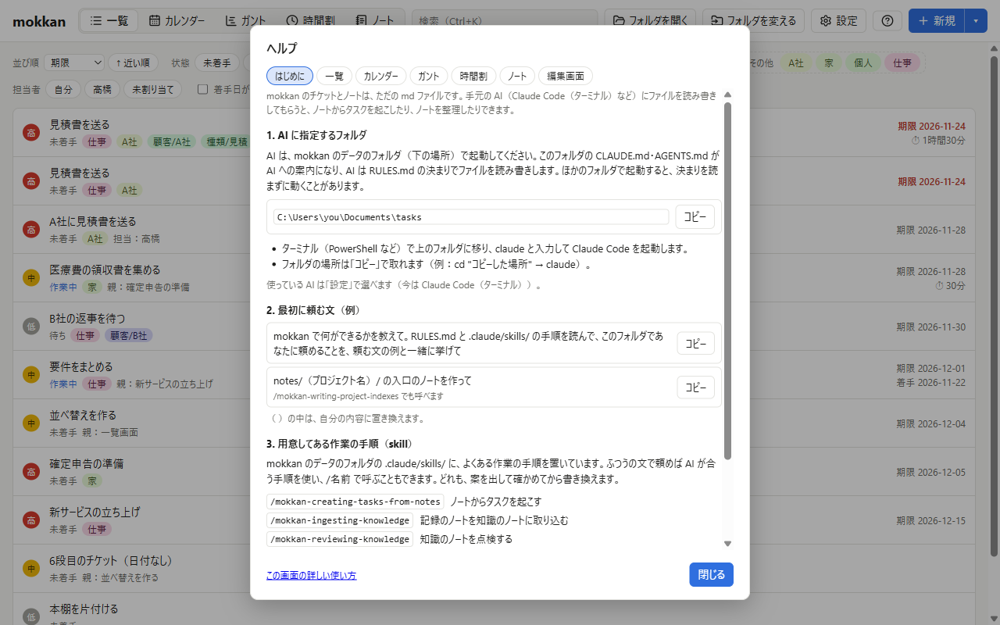

- **AI に指定するフォルダ**：AI は `tasks` フォルダで起動します。そこの `CLAUDE.md`・`AGENTS.md` が AI への案内になり、AI は `RULES.md` の決まりと skill の手順でファイルを読み書きします。フォルダの場所は「コピー」で取れます。
- **起動のしかた**：設定の「使っている AI」（Claude Code（ターミナル）・Claude のデスクトップアプリの Code・Cursor）に合わせて書き分けます。
- **最初に頼む文**・**用意してある作業の手順（skill）**：「コピー」で文をコピーして、AI に貼ります。

## 上の帯

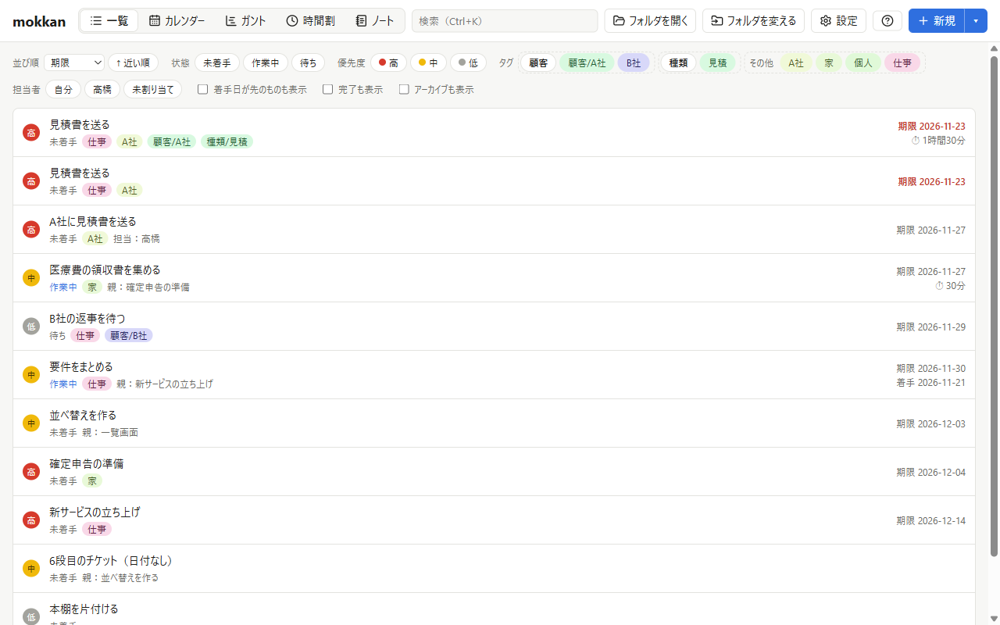

- **表示の切り替え**：一覧・カレンダー・ガント・時間割・ノートを切り替えます。
- **検索（Ctrl+K）**：チケット・ノート・アーカイブを、タイトルと本文から探します。空白で区切ると「すべて含む」で探します。ひらがなとカタカナ、全角と半角、大文字と小文字は区別しません。ノートの「文字起こし」は、「ノートの文字起こしも探す」を付けたときだけ探します。結果を選ぶと開き、本文の当たった箇所まで動きます。
- **フォルダを開く**：`tasks` フォルダをエクスプローラーで開きます。
- **フォルダを変える**：別の `tasks` フォルダを選びます。
- **設定**：[設定](#設定) を開きます。確かめてほしいことがあるときは、印（点）が付きます。
- **？**：ヘルプを開きます。今の画面のタブで開きます。
- **＋ 新規（Ctrl+N）**：チケット（ノートの画面ではノート）を作ります。▾ で `tasks/templates/` のテンプレートを選べ、選んだものは次から Ctrl+N の既定になります。
- **← 戻る（Alt+←）**：前に開いていたチケットやノートに戻ります（編集画面の上）。
- 窓が狭いときは、ボタンの文字を消してアイコンだけにします（名前はマウスを乗せると出ます）。

## 一覧

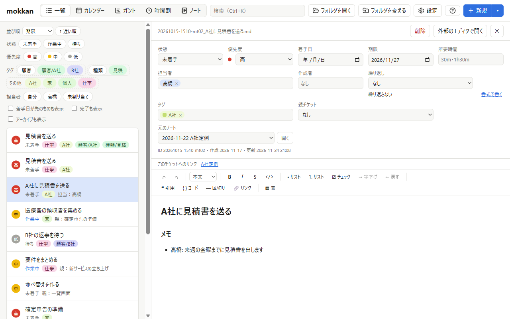

- 未完了のチケットを並べます。押すと右の [編集画面](#編集画面) で開きます。
- **並び順**：期限・着手日・優先度・作成日・更新日時・状態・タイトルから選び、近い順／遠い順を切り替えます。選んだ並び順は覚えます。
- **絞り込み**：状態・優先度・タグ・担当者で絞り込みます。
  - タグは、キーのあるタグ（`顧客/A社` の「顧客」）ごとにまとまります。キーを押すと、その値すべてを選びます。同じキーの値どうしは「または」、違うキーどうしは「かつ」です。
  - 担当者の「自分」は、設定の「自分の名前」です。「未割り当て」は担当者のないチケットです。
  - 「着手日が先のものも表示」「完了も表示」「アーカイブも表示」で、隠しているものも出します。
- **行の表示**：優先度の丸（高＝赤、中＝黄、低＝灰）・状態・タグ・親チケット・担当者・期限・着手日・所要時間を出します。期限を過ぎたものは赤です。
- **まとめてアーカイブ…**：完了してから指定した日数がたったチケットを、子チケットも一緒に `archive/` に移します。
- **境目**：一覧と編集画面の境目はドラッグで動かせます（ダブルクリックで元の幅）。

## カレンダー

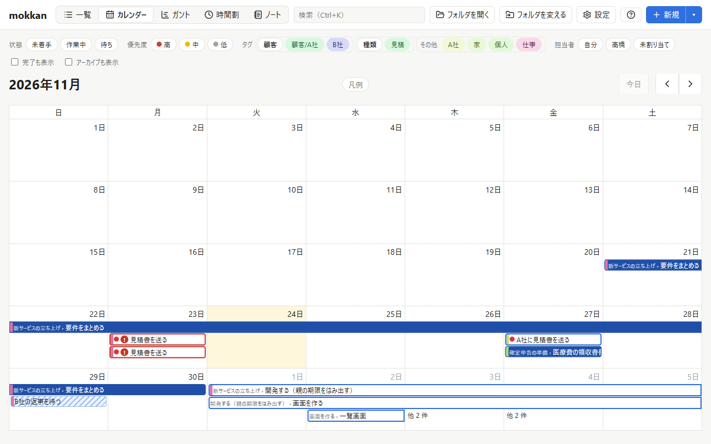

- 月表示で、期限の日（着手日があれば着手日から期限までの帯）にチケットを置きます。
- 上の矢印で前後の月に、「今日」で今月に戻ります。予定を押すと右に開きます。
- 塗り方が状態（未着手＝枠だけ、作業中＝濃い塗り、待ち＝淡い斜線、完了＝灰色）、左の線がタグの色、赤い丸が優先度の高、赤い枠と「!」が期限切れです。「凡例」で色の意味を出します。
- 子チケットは「親 › 子」と出し、親を子より上に並べます。

## ガント

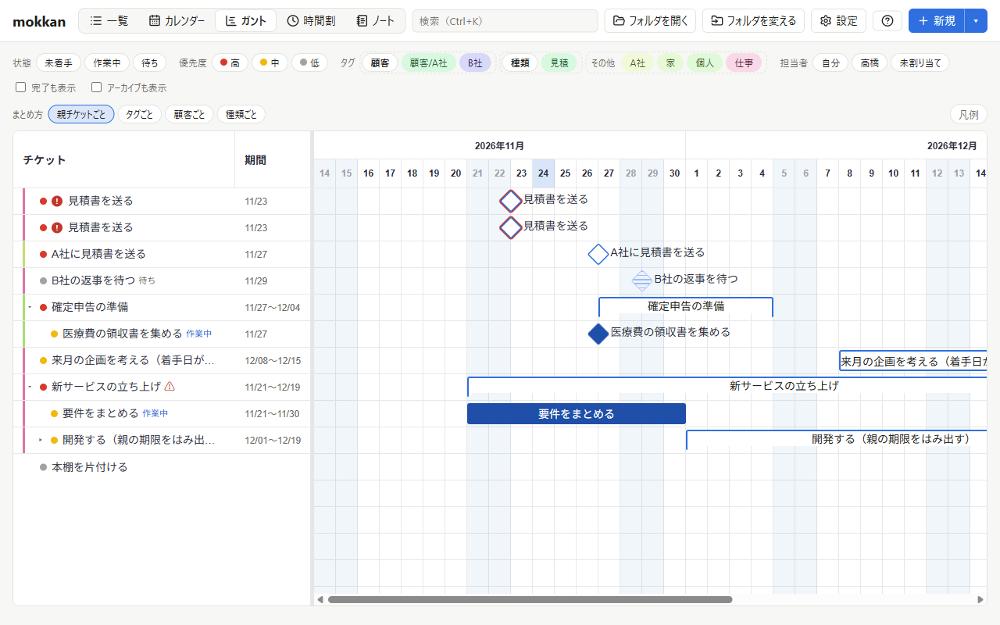

- 着手日から期限までを棒で出します。着手日がないチケットは、期限の日に印だけを出します。
- **まとめ方**：親チケットごと（親→子→孫の階層）・タグごと、キーのあるタグがあれば「顧客ごと」のようにキーの値ごとにもまとめます。
- 親の棒は子孫全体の期間のまとめ棒で、親の期限を子がはみ出すと ⚠ が出ます。親ごとに折りたためます。
- 棒の塗り方はカレンダーと同じで、完了は灰色＋取り消し線、期限切れは赤い枠と「!」です。棒を押すと右に開きます。
- 絞り込んだときは、条件に合う子孫の祖先も薄く出して、何の作業かわかるようにします。

## 時間割

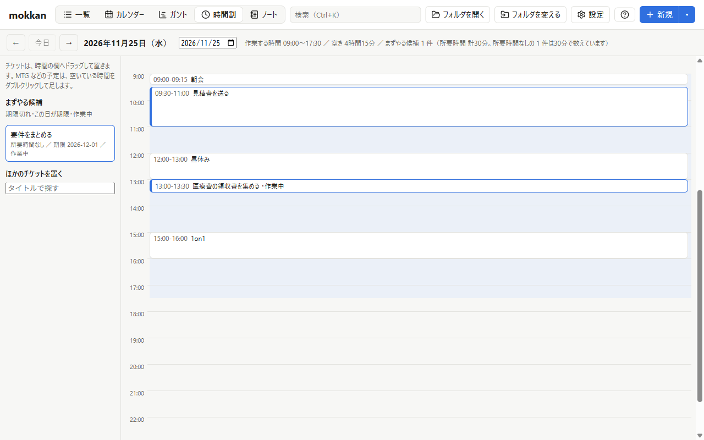

その日一日の、何時から何時に何をするかを組みます。時間割は `tasks/days/YYYY-MM-DD.md` に1行ずつ `- 10:00-11:00 内容` で書かれるので、ほかのエディタや AI でも読み書きできます。

- **日の移動**：「←」「→」で前後の日に、「今日」で今日に戻ります。日付の欄で日を選ぶと、その日に移ります。今日は今の時刻に赤い線を引きます。作業する時間（設定か `days/routine.md` の `work`）の帯を薄く塗ります。
- **候補**：左に、まだその日に置いていない未完了のチケットを並べます。時間の欄へドラッグすると、所要時間（なければ30分）の長さで置きます。押すと開きます。
  - まずやる候補：期限切れ・その日が期限・作業中のもの。
  - 着手日を過ぎたもの：期限はまだ先（または期限なし）で、着手日がその日までのもの。数が多くなりやすいので、折りたたんであります。
  - 待ち（返事待ち・保留）のチケットと、未完了の子チケットを持つ親は並べません（親の作業は子で置きます）。
  - ほかのチケットを置く：候補にないチケット（期限や着手日のないもの、先が期限のもの）は、タイトルで探して置けます。
- **予定を足す**：空いている時間をダブルクリックすると、MTG・昼休みなど、チケットでない予定を打ち込めます（1時間）。「追加」か Enter で足し、「やめる」か Esc でやめます。
- **動かす・長さを変える**：予定をドラッグすると動き、下の端をドラッグすると長さが変わります（15分刻み）。チケットやノートの予定は、押すとそれを開きます。重なった予定は横に並べます。
- **予定のボタン**（予定にマウスを乗せるか、Tab で予定に移ると出ます。Enter でリンク先を開きます）：
  - 完了にする：チケットを完了にします。押し間違えないよう、確かめてから完了にします（繰り返しがあれば次回分もできます）。
  - 書き換え：文字だけの予定の内容を書き換えます（「保存」か Enter で決め、「やめる」か Esc でやめる）。
  - 議事メモ：文字だけの予定（MTG など）から議事メモを作ります。テンプレートとプロジェクトのフォルダを選ぶと、その日を日付にしたノートを作り、予定をそのノートへのリンクに変えます。
  - 外す：時間割から外します（チケットやノートは消しません）。文字だけの予定は、外すと内容ごとなくなるので、確かめてから外します。
- **いつもの予定**：`tasks/days/routine.md` に、繰り返しの予定を書きます（`- weekly:tue 10:00-11:00 定例MTG`。規則はチケットの繰り返しと同じで、隔週などは `every:2w@2026-11-10` のように数え始めの日を付けます）。その日の時間割のファイルを初めて作るときに写します。ファイルの先頭の `work: 09:00-18:00` は作業する時間です（設定の画面でも変えられます）。
  - まだファイルがない日は点線で出し、予定を足したときにファイルを作ります。その日だけ休みの予定は、点線の予定の「この日は外す」で外せます。
  - ファイルがある日に、そこにないいつもの予定（その日は外したもの、手や AI で作ったときの写し忘れ）があれば、上に出します。「写す」で足せます。あるかどうかは予定の内容（リンクならリンクの文字）で見分けます。議事メモを作るときにタイトルを変えた予定は「ない」と出ることがあるので、「写す」を押す前に時間割を見てください。
  - 中止の回は、その日の予定を外します。
- **入り切るかの目安**：上に、作業する時間・空き・まずやる候補の数と所要時間の合計を出し、入り切らなければ「入り切りません」と出します。所要時間のない候補は30分で数えます（AI に時間割を組んでもらうときと同じ）。
- **読めない行**：時刻の書き方が違う行は、消さずに上に出します。ファイルを直してください。

## ノート

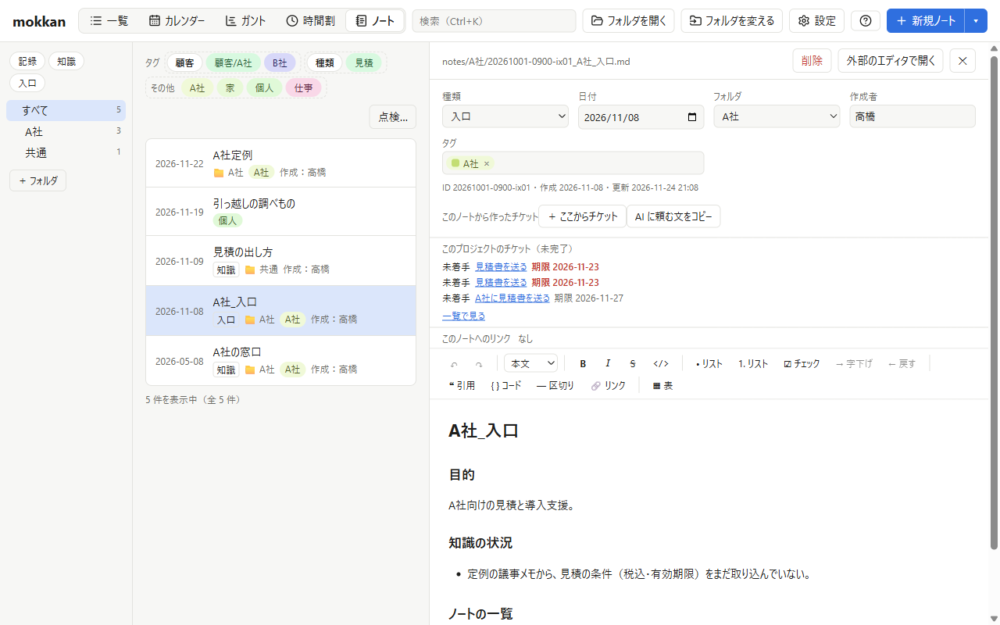

議事メモ・メモ・調べたこと・手順などを、チケットと同じ `tasks` フォルダの `notes/` に書きます。

- **フォルダの木**：左で、プロジェクトのフォルダ（`notes/案件A/` など）を選んで絞り込みます。「＋ フォルダ」で、選んでいるフォルダの中にフォルダを作ります。
- **種類**：上の「記録・知識・入口」で絞り込みます。
  - 記録：議事メモ・作業の記録など、その時に起きたこと。後から書き換えません。
  - 知識：手順・仕様・今の決まりなど、今の正しい状態。変わったら書き換え、見直した日を付けます。
  - 入口：プロジェクトのフォルダに1つ置く、そのプロジェクトの目的・知識の状況・知識のノートの一覧。
- **＋ 新規ノート（Ctrl+N）**：木で選んでいるフォルダに作ります。▾ で議事メモ・手順・参照・解説・入口のテンプレートを選べます。
- **一覧**：日付・種類・フォルダ・タグ・作成者と、知識のノートの見直した日、ノートから作ったチケットの進み具合を出します。
- **入口のノート**を開くと、そのプロジェクトの未完了のチケット（5件まで）が上に出ます。「一覧で見る」で、そのプロジェクトのタグで絞り込んだ一覧に切り替えます。

### 点検

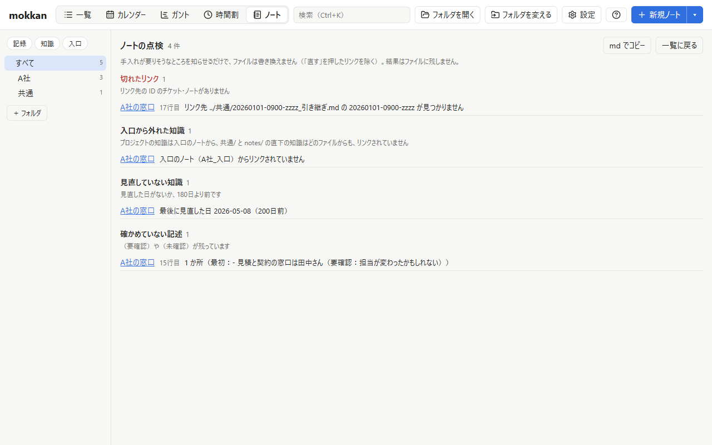

ノートの画面の「点検…」で、手入れが要りそうなところを種類ごとに出します（切れたリンク・ずれたリンク・入口のノートがないプロジェクト・入口から外れた知識・長く見直していない知識・確かめていない記述・長すぎる知識）。

- ずれたリンク（リンク先の名前やフォルダが変わったもの）は「直す」で、今のファイルを指すように書き換えます。
- 「md でコピー」で結果をコピーし、そのまま AI に貼ると、直す案を出してもらえます（`mokkan-reviewing-knowledge`）。
- 結果はファイルに残しません。

## 編集画面

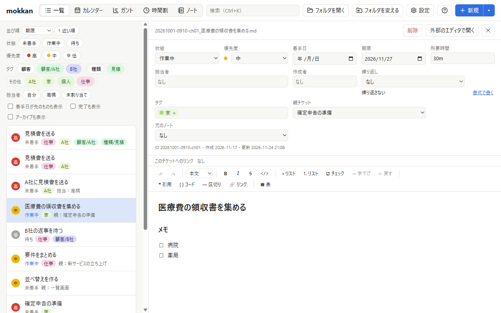

チケットとノートを、同じ編集画面で開きます。保存は自動です。

- **プロパティ**（チケット）：状態・優先度・着手日・期限・所要時間・担当者（複数人も）・作成者・繰り返し・タグ・親チケット・元のノート。変えた項目の行だけをファイルに書きます。
  - 所要時間は `30m`・`1h`・`1h30m` で入れます（`90` のように数だけなら分）。
  - 繰り返しは、種類（毎日・平日・毎週・毎月・毎年・◯日ごと・完了から◯日後）を選ぶと、必要な項目だけが出ます。完了にすると次回分のチケットを作ります。
  - タグのチップの左の色の印で、タグの色を選べます（`tasks/TAGS.md` に保存）。
  - 親チケットを開くと、子チケットの一覧も出ます。
- **本文**：見出し・太字・斜体・取り消し線・コード・リスト・チェックボックス・字下げ・引用・コードブロック・区切り線・リンク・表をツールバーで付け外しします。
  - `[[`（`「「`）と打つと、チケットやノートの候補が出て、選ぶとリンクが入ります。本文の ID やリンクは Ctrl+クリックで開きます。
  - 開いて保存しただけでは、編集していない部分は1文字も変えません。
- **このチケットへのリンク**：このチケットにリンクしているチケット・ノートを出します。
- **上のボタン**：アーカイブ（完了したチケットだけ）・アーカイブから戻す・削除（確かめてから、子チケットと一緒に Windows のごみ箱に移す）・外部のエディタで開く・閉じる。
- 編集中に外（AI やほかのエディタ、同期）でファイルが変わったときは、上書きせずに、どちらを残すかを選べます。

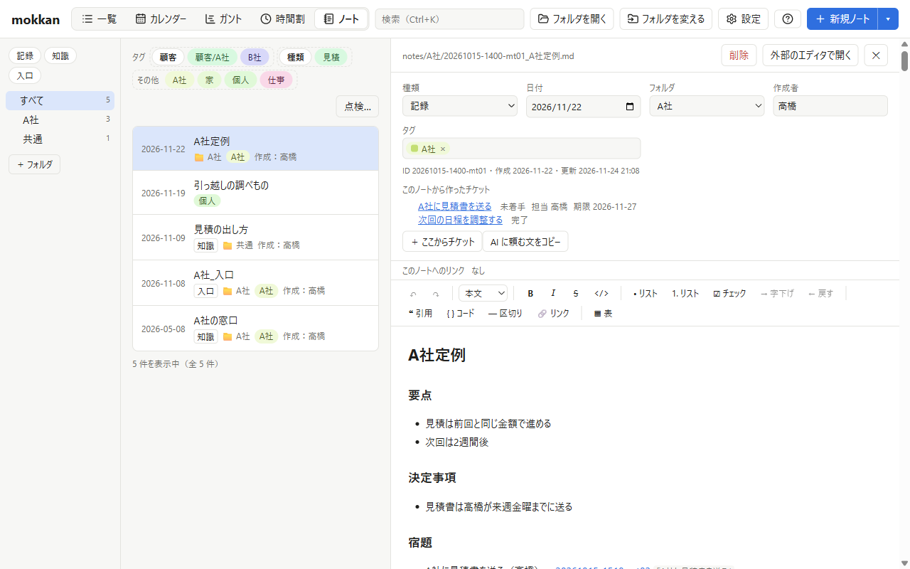

- **プロパティ**（ノート）：種類・日付・見直した日（知識のノート）・フォルダ（選ぶとそのフォルダに移す）・作成者・タグ。
- **このノートから作ったチケット**：このノートから起こしたチケットを、状態付きで並べます。
- **＋ ここからチケット**：ノートから手でチケットを起こします。「宿題」の項目にカーソルを置いて押すと、その文がタイトルに、「（高橋）」が担当者に入り、作ると行の最後に「→ チケットへのリンク」を書き足します。
- **AI に頼む文をコピー**：このノートからタスクを起こしてもらう文をコピーします。AI のアプリで `tasks` フォルダを開いて貼ると、候補を出してくれます（作るのは確かめてから）。

## 設定

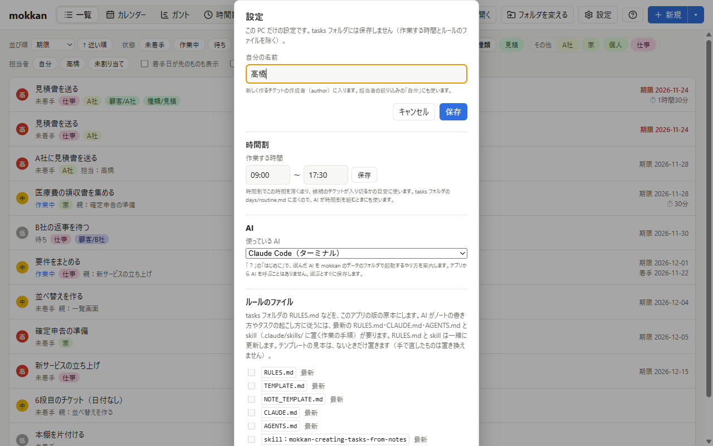

この PC だけの設定です（`tasks` フォルダには書きません。作業する時間だけは、AI も読めるように `tasks` フォルダに書きます）。

- **自分の名前**：新しく作るチケットの作成者と担当者に入ります。担当者の絞り込みの「自分」にも使います。
- **時間割**：作業する時間（初期は 9:00〜18:00）。時間割で薄く塗り、入り切るかの目安に使います。`tasks/days/routine.md` の先頭（`work: 09:00-18:00`）に書くので、AI が時間割を組むときもこの時間に収めます。ファイルを直接直しても構いません。
- **AI**：使っている AI。「はじめに」の起動のしかたを書き分けるためだけに使います（アプリから AI を呼ぶことはありません）。
- **ルールのファイル**：`tasks` フォルダの RULES.md・テンプレート・CLAUDE.md・AGENTS.md・skill が、このアプリの版の原本と同じかを確かめ、選んだものを最新にします。手で直したものは、今のファイルを Windows のごみ箱に移してから置き換えます。RULES.md と skill は一緒に更新します。新しい版を入れたら、ここで更新してください。

## AI と使う

mokkan のチケットとノートは、ただの md ファイルです。ファイルを読み書きできる AI のアプリ（Claude Code・Claude のデスクトップアプリの Code・Cursor など）を `tasks` フォルダで使うと、AI がチケットやノートを扱えます。アプリから AI を呼ぶことはありません。

- **決まり**：AI は `tasks/RULES.md`（チケットとノートの書き方）を先に読みます（`CLAUDE.md`・`AGENTS.md` にそう書いてあります）。
- **標準の skill**：`tasks/.claude/skills/` に、よくある作業の手順を置いています。ふつうの文で頼めば AI が合う手順を使い、`/名前` で呼ぶこともできます。どれも、案を出して人が確かめてから書き換えます。

| skill | すること |
| --- | --- |
| `mokkan-creating-tasks-from-notes` | ノートからタスクを起こす（候補を出す→選ぶ→作る→「宿題」に書き戻す。日時の決まった次の MTG があれば、時間割に足す提案も） |
| `mokkan-ingesting-knowledge` | 記録のノートを、知識のノートと入口のノートに取り込む |
| `mokkan-reviewing-knowledge` | 知識のノートを点検し、直す案を出す（アプリの「点検」の結果を貼っても） |
| `mokkan-writing-project-indexes` | プロジェクトの入口のノートを作る・直す |
| `mokkan-tidying-tickets` | 期限切れ・止まっている・担当や期限のないチケットを見直す |
| `mokkan-planning-days` | その日の時間割を組む（MTG を入れる・カレンダーの連携から取り込むときも） |

- **頼む文の例**：ヘルプの各タブの「手元の AI に頼めること」から、「コピー」で取れます。
- AI のアプリは `tasks` フォルダのファイルを自分で読みます。議事メモの文字起こしなど、読ませたくないものは、別のファイルやフォルダに分けるか、頼むときに「読まないで」と書き添えてください。

## ファイルの決まり

- 1チケット＝1つの md ファイル（`tickets/`）。先頭の frontmatter に状態や期限、本文にタイトルとメモを書きます。書き方は [RULES.md の原本](../templates/RULES.md) にあります。
- 特定のツールの独自記法を使わない標準の md なので、ほかのエディタや GitHub で開いても崩れません。
- ファイル名は `ID.md` か `ID_見出し.md` です。「新規」で作ったチケットとノートは `ID.md` で、次に起動したときに見出しを付け足した名前にします（作成者が自分か空のものだけ）。
- 完了したチケットは、アーカイブで `archive/` に移して片付けます（名前も中身も変えない）。
- 削除は、Windows のごみ箱に移します。アプリがファイルを完全に消すのは、自分で作って何も書かずに閉じたチケットとノートだけです。
- AI・ほかのエディタ・クラウドの同期で変わったファイルは、すぐ画面に反映します。

## 警告

一覧の上に、確かめてほしいファイルを出します。

- 同期サービスの競合コピー・同じ ID のファイルが2つ
- ファイル名の ID と、frontmatter の `id` の食い違い
- frontmatter が読めない
- 親が見つからない・循環している親子
- 着手日が期限より後
- 元のノートが見つからない
- タグの色のファイル（`TAGS.md`）が読めない・競合コピーがある
